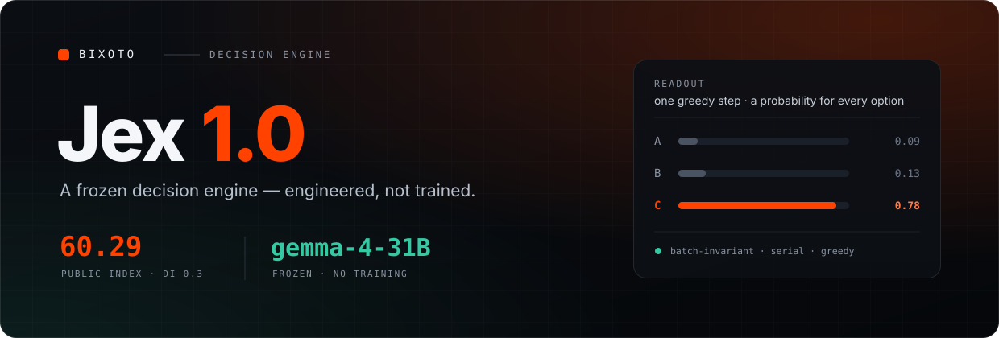
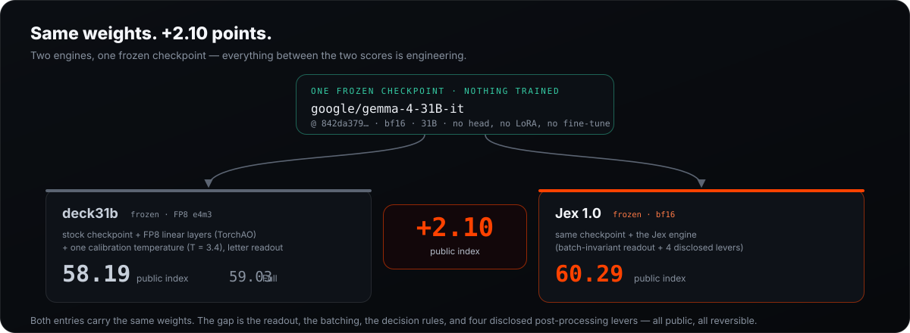
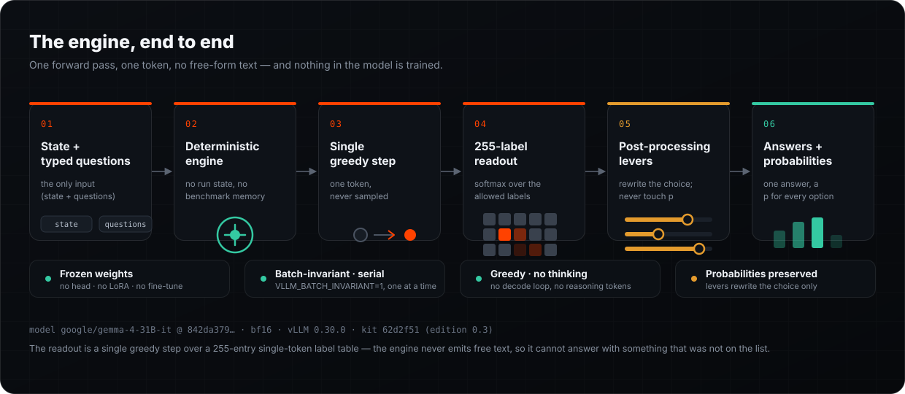
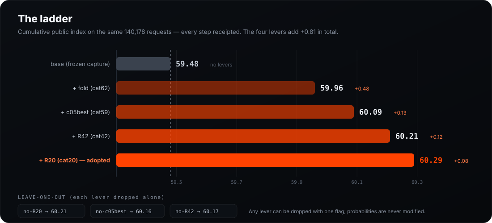
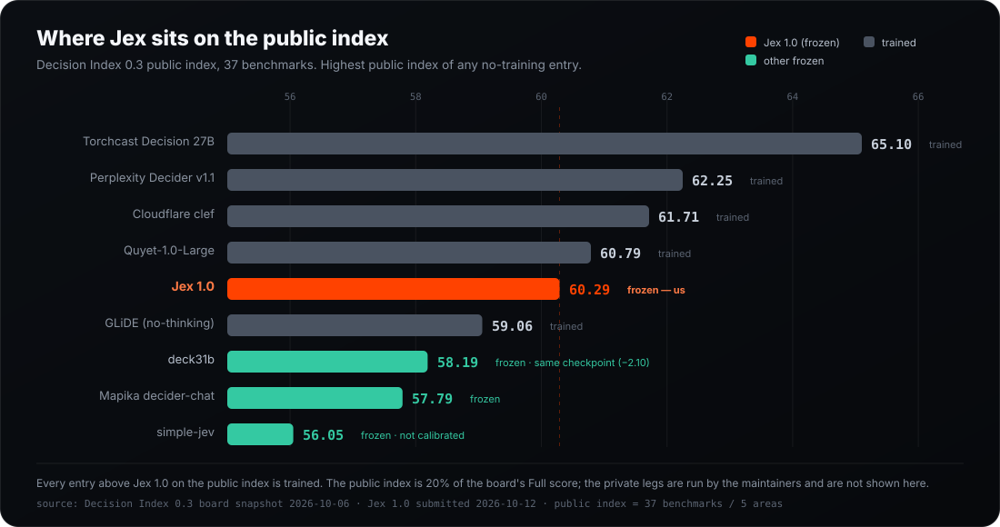
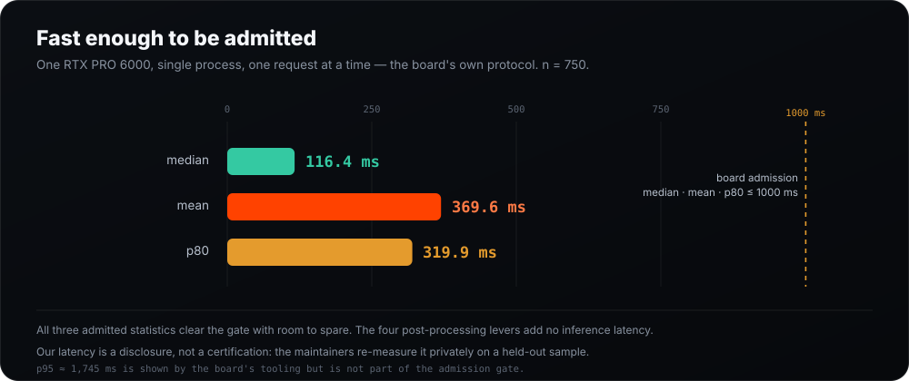
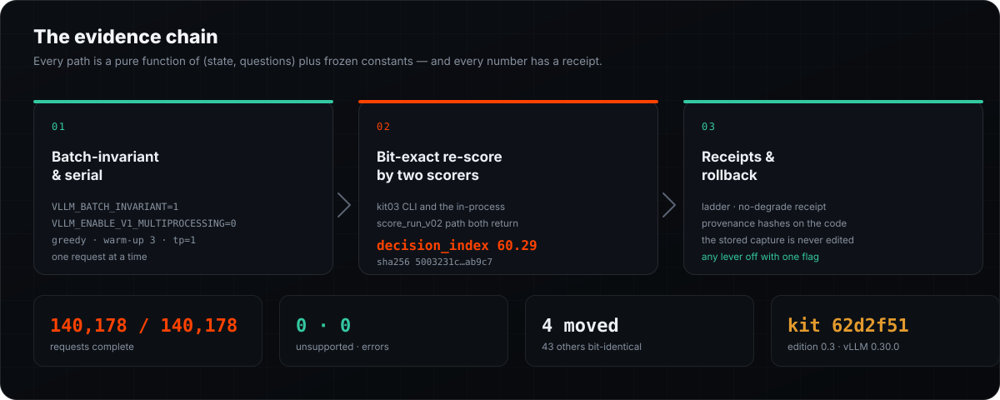

<p align="center">
  
</p>

<h1 align="center">Jex 1.0</h1>

<p align="center">
  <b>The strongest frozen decision engine on Decision Index 0.3.</b><br>
  A stock <code>gemma-4-31B</code> checkpoint driven to a <b>60.29 public index</b> by a deterministic inference engine.
</p>

<p align="center">
  
  
  
  
  
</p>

---

**Jex 1.0 is a decision engine, not a language model.** Give it a state and a set of typed questions and it returns one answer per question with a probability for every allowed option — in a single forward pass, with no free-form text and no output parsing. It cannot answer with something that was not on the list.

The point of Jex is what it *doesn't* do. The weights are `google/gemma-4-31B-it`, frozen: no head, no LoRA, no fine-tuning, no RL. Every one of the **+2.10 public-index points** it holds over the next-best frozen entry on the board (deck31b, running the *same* checkpoint) comes from the engine around the model — the readout, the batching, the decision rules, and four disclosed post-processing levers.

It was built at **[Bixoto](https://bixoto.com)** for production use, and is published here as-is: a complete, byte-reproducible, determinism-audited run with every number receipted and every lever reversible.

> Same frozen checkpoint as the peer. **+2.10 points.** All engineering.

---

## Why it's different

1. **Engineered, not trained.** The base checkpoint is untouched (`842da379…`, bf16). The readout is a single greedy step over a 255-entry single-token label table. Nothing about the model's forward pass changes.
2. **The cleanest head-to-head on the board.** deck31b runs the same `gemma-4-31B-it` checkpoint with FP8 and one temperature and lands at **58.19 public / 59.03 Full**. Jex 1.0 lands at **60.29 public**. Everything between the two entries is engine work — and it is all public.
3. **Determinism you can verify at home.** Batch-invariant and serial, a pure function of `(state, questions)` plus frozen constants. The packaged results file re-scores **bit-exact 60.29** under two independent scorers.
4. **Every number has a receipt.** A documented ladder with leave-one-out checks, a no-degrade receipt, provenance hashes on the lever code, one-flag rollback, and honest disclosure of the two projection classes.

<p align="center">
  
</p>

---

## Quickstart

The engine runs on vLLM and needs one RTX PRO 6000-class GPU (96 GB, sm_120). The fastest way to see it work is to reproduce the submitted score from the results file:

```bash
# environment (GPU host)
pip install -r requirements.txt          # vllm==0.30.0, transformers==5.14.1

# re-score the submitted results — reproduces 60.29 bit-exactly
PYTHONPATH=<kit03> python -m decision_index.cli score \
  --edition 0.3 --suite-dir <suite03> \
  --results runs/jex-1.0/results-combined.jsonl.gz \
  --out runs/jex-1.0/score
# expect: decision_index 60.29 · complete true · completed 140178
```

To run the engine on your own rows:

```bash
VLLM_BATCH_INVARIANT=1 python3 harness/vllm_pipeline.py \
  --rows <rows.jsonl.gz> --reference <any non-empty results.jsonl.gz> \
  --model google/gemma-4-31B-it --dtype bfloat16 --tensor-parallel-size 1 \
  --max-model-len 8192 --gpu-memory-utilization 0.9 --max-num-seqs 32 \
  --attention-backend TRITON_ATTN --cudagraph-mode FULL_DECODE_ONLY \
  --rendering reference --slot paren --trust-remote-code \
  --cap 512 --fast-batch 8 --reason-batch 32 \
  --temperature-by-options "10.124 -1.633 0.05" \
  --kit-root <repo>/kit --out <merged.jsonl.gz> --fast-out <fast.jsonl.gz>
```

`<kit03>`/`<suite03>` are a checkout of the [Decision Index 0.3 kit](https://github.com/apolinario/decision-index) at `62d2f51` and the suite it builds. Full runnability notes are in [`ENGINE-PACKAGE.md`](ENGINE-PACKAGE.md); the exact re-score and hashes are in [`REPRO.md`](REPRO.md).

---

## Architecture

<p align="center">
  
</p>

The engine is the whole difference between Jex and the stock checkpoint:

- **Deterministic engine.** No run state, no benchmark knowledge, no row-id-keyed artifact is consulted at inference time. The path is a pure function of the input.
- **Single greedy step.** One token, never sampled. There is no decode loop and no reasoning pass — the board quarantines thinking to a separate board, and the main board is a single-pass lane that Jex expresses purely.
- **255-label readout.** The next-token logits over a fixed table of 255 single-token labels are softmaxed. Presentation is fixed (`rendering reference`, slot `paren`) for every request; there is no prompt tuning.
- **Post-processing levers.** Four disclosed, deterministic overlays rewrite **only** the emitted choice — never a probability. Each is one flag away from being switched off.

### The decision pipeline (order)

1. **Decision rules** — signature-scoped rules (iSarcasm / ACOS / FinEntity).
2. **K = 2 option-position prior** — a decision transform on position 0 (the first presented option).
3. **TBO** — temperature by options: `max(0.05, 10.124 − 1.633 · ln n)`.
4. **Forced-choice fallback** — every option carries a probability; no option is filtered, nothing is truncated.

The dual-config router runs two batch-invariant workers: `≤8190` tokens on an `8192` worker, longer on a `24576` worker. Prompts above `24576` tokens are declared `unsupported`, counted as wrong, and never truncated (0 on the public suite).

---

## Usage

The engine consumes rows in the kit schema and emits one result row per request. A request is exactly `state` + `questions`; the response is one answer per question with a probability for every allowed option. This is a real (trimmed, rounded) row from `runs/jex-1.0/results-combined.jsonl.gz`:

```jsonc
// → the engine sees only these two fields
{
  "state": { "conversation": [/* ... */], "task": "…" },
  "questions": {
    "intent": {
      "type": "choice",
      "criteria": {
        "ReserveRestaurant": "Invoke this intent.",
        "FindRestaurants":    "Invoke this intent.",
        "NONE":               "No intent is correct."
      }
    }
  }
}

// ← one result row
{
  "run_id": "10:SGD-service-given-intent:…:1_00003:0:0",
  "catalog_id": 10,
  "dataset": "SGD/SGD-X",
  "engine": "di-engine-0.3",
  "status": "ok",
  "response": {
    "model": "google/gemma-4-31B-it",
    "answers": {
      "intent": {
        "type": "choice",
        "choice": "NONE",
        "probabilities": {
          "ReserveRestaurant": 0.0913,
          "FindRestaurants":   0.1280,
          "NONE":              0.7807
        }
      }
    },
    "usage": { "input_tokens": 1906 }
  },
  "total_wall_ms": 436.1
}
```

`noul` questions are answered the same way (`{"type": "noul", "noul": p_yes}`). Declared capacity limits live in `environment.json` and in the `unsupported` counts.

---

## Results

**Public index 60.29** (Decision Index 0.3) — the highest public index of any no-training entry on the board.

| metric | value |
|---|---:|
| public index (Decision Index 0.3) | **60.29** |
| balanced raw | 69.88 |
| breadth skill | 59.25 |
| requests | **140,178 / 140,178 ok** |
| unsupported · error | 0 · 0 |
| `complete` | `true` |
| coverage | 1.0 (no reasoning) |

> The public index is the chance-corrected score over the 37-benchmark public panel (5 areas). It is **not** the board's Full score, which adds 50% private same-skills tests and 30% private new-domain tasks run by the maintainers. This repository makes no Full-score or rank claim.

### The ladder

Every step is cumulative and receipted on the same 140,178 requests. The four levers add **+0.81** together.

| step | stack | public index |
|---|---|---:|
| base | frozen capture, no levers | 59.48 |
| + fold | cat62 fold (`D`, τ = −13.63) | 59.96 |
| + c05best | cat59 isotonic · shrink λ = 0.75, nf = 10 | 60.09 |
| + R42 | cat42 `Entailment` (τ = −8) | 60.21 |
| **+ R20** | cat20 `option_0` (τ = +15) | **60.29** |

Leave-one-out checks (each lever dropped in isolation): **no-R20 → 60.21**, **no-c05best → 60.16**, **no-R42 → 60.17**. Exactly four catalogs move (62, 59, 42, 20); every other catalog is bit-identical — the **43/43 no-degrade receipt**.

<p align="center">
  
</p>

### The four levers

| lever | catalog | rule | provenance |
|---|---|---|---|
| **fold** | 62 When2Call | emit `D` if `logit(p_work[D]) ≥ −13.63` | positional construction-reuse → **public-suite projection** |
| **c05best** | 59 RAGTruth (`noul`) | isotonic · shrink λ = 0.75, nf = 10 (OOF) | **fitted on the public OOF panel** |
| **R42** | 42 NLI4CT | emit `Entailment` if `logit ≥ −8` | **threshold fitted on the public OOF panel** |
| **R20** | 20 BPoMP | emit `option_0` if `logit ≥ +15` | positional construction-reuse → **public-suite projection** |

Probabilities are never modified: only the emitted `choice` (recovered to the pre-TBO rule space) and the cat59 `noul` field are overwritten. The stored capture is never edited. See [Disclosures](#disclosures--limitations).

### Where Jex sits on the public index

<p align="center">
  
</p>

Every entry above Jex 1.0 on the public index is trained. Among no-training entries, the next best is deck31b (58.19, same checkpoint) — **+2.10**; then the frozen Mapika `decider-chat` (57.79) and simple-jev (56.05).

| entry | training | public index | Full | median ms | source |
|---|---|---:|---:|---:|---|
| Torchcast Decision 27B | LoRA | **65.10** | 59.91 | 99.9 | board 0.3 |
| Perplexity Decider v1.1 (27B) | full fine-tune | 62.25 | **62.75** | 104.1 | board 0.3 |
| Cloudflare clef | post-trained | 61.71 | 53.08 | 102.1 | board 0.3 |
| Quyet-1.0-Large | LoRA | 60.79 | 58.71 | 105.4 | board 0.3 |
| **Jex 1.0** | **none — frozen** | **60.29** | pending | 116.4 | this run |
| GLiDE (Fastino, no-thinking) | full fine-tune | 59.06 | 60.21 | 98.4 | board 0.3 |
| deck31b | **none — frozen** | 58.19 | 59.03 | 218.5 | board 0.3 |
| Mapika `decider-chat` | none — frozen | 57.79 | 57.62 | 108.5 | board 0.3 |
| simple-jev | none — frozen | 56.05 | 51.79 | 373.0 | board 0.3 |

Higher is better. Board snapshot 2026-10-06; Jex 1.0 submitted 2026-10-12. "Full" and peer public-index figures are the board's own numbers, not ours.

---

## Latency

<p align="center">
  
</p>

Measured on one RTX PRO 6000 96 GB, single process, one request at a time — the board's own admission protocol (n = 750 timed rows, serial, batch-invariant).

| statistic | value | board gate |
|---|---:|---:|
| median | **116.4 ms** | ≤ 1000 |
| mean | **369.6 ms** | ≤ 1000 |
| p80 | **319.9 ms** | ≤ 1000 |
| n | 750 | — |

The four post-processing levers add no inference latency. This is a **disclosure, not a certification**: the maintainers re-measure latency privately on a held-out sample. `p95` (≈ 1,745 ms) is displayed by the board's tooling but is not part of the admission gate.

---

## Reproducibility

<p align="center">
  
</p>

| pin | value |
|---|---|
| base model | `google/gemma-4-31B-it` @ `842da3794eaa0b77d5f08bae87a17459d91ff475` (bf16) |
| engine | `Bixoto/jex` @ `88dafa36ff31b828cc305f2cc996fcb88003dab3` |
| kit / edition | `62d2f51de34a2de64906345b6bc3e98e27ff55c7` (edition 0.3) |
| runtime | vLLM `0.30.0`, transformers `5.14.1` |
| results file sha256 | `5003231c9757d430ff9439c17a0e20f166b8d3dacef1dcde66e49056708ab9c7` |
| suite hashes | selected `b2b56d6f…` · added `7429f3c9…` · gsm8k `75933489…` |
| hardware | 1 × NVIDIA RTX PRO 6000 96 GB (Blackwell, sm_120) |

- Every path is a **pure function** of `(state, questions)` plus frozen constants — batch-invariant (`VLLM_BATCH_INVARIANT=1`) and serial (`VLLM_ENABLE_V1_MULTIPROCESSING=0`), greedy, determinism warm-up 3, `TRITON_ATTN`, `FULL_DECODE_ONLY`, tp = 1.
- The packaged combined file re-scores **bit-exact 60.29** under two independent scorers: the kit03 CLI *and* the in-process `score_run_v02` path.
- **Rollback:** drop any single lever by re-running `levers/run_variants.py` with that flag set to `False` (or `build_combined.py` restricted to the remaining catalogs). Dropping the whole stack returns to the base **59.48**. Probabilities are never modified.
- `levers/PROVENANCE.sha256` records the source hash of every copied lever file and the only rewrites applied (path constants; no rule or parameter change).

---

## Settings

| setting | value |
|---|---|
| model | `google/gemma-4-31B-it` |
| revision | `842da3794eaa0b77d5f08bae87a17459d91ff475` |
| dtype | `bfloat16` |
| runtime | vLLM `0.30.0` · transformers `5.14.1` |
| batch invariance | `VLLM_BATCH_INVARIANT=1` |
| multiprocessing | `VLLM_ENABLE_V1_MULTIPROCESSING=0` |
| concurrency | serial — one request at a time |
| attention backend | `TRITON_ATTN` |
| cudagraph mode | `FULL_DECODE_ONLY` |
| tensor parallel | 1 |
| `max_num_seqs` | 32 |
| gpu memory util | 0.90 |
| sampling | greedy |
| determinism warm-up | 3 |
| rendering / slot | `reference` / `paren` |
| label table | 255 single-token labels |
| `MAX_LOGPROB_IDS` | 128 |
| router | `single_long`: ≤ 8190 → 8192 worker · longer → 24576 worker · > 24576 → `unsupported` |
| decision pipeline | rules → K = 2 prior → TBO `max(0.05, 10.124 − 1.633·ln n)` → forced-choice fallback |

---

## Repository layout

```
engine/            label-slot readout engine (render, readout, labels, decision rules, config)
harness/           vLLM run pipeline (serial, batch-invariant), rule application
levers/            deterministic post-processing overlay (code + exact parameters + fetch_inputs.sh + provenance)
requirements.txt
ENGINE-PACKAGE.md  maintainer-runnability package description
DISCLOSURES.md     mandatory disclosures (lever provenance, fitting, determinism, rollback)
LADDER.md          cumulative ladder + leave-one-out checks
REPRO.md           full reproduction chain + exact re-score command + file hashes
REPRO-INPUTS.md    reproduction inputs: what ships where, what is documented-only
INPUTS.md          exact construction & provenance of the reproduction inputs
SUBMISSION.md      submission row / entry description
LATENCY-CERTIFICATE.md  S1-certified latency
assets/            the diagrams in this README (hand-authored SVG)
```

The reproduction inputs — the frozen base capture, the fitted `table.pkl`, and the cat62 folded file — **are** shipped now, in the results dataset under `runs/jex-1.0/inputs/`; restore them into the layout the packaged scripts expect with `levers/fetch_inputs.sh`. The evaluation **kit and suite** are not ours to redistribute: a third party fetches them from the official `apolinario/decision-index` checkout. The overlay is certified end to end by rebuilding the combined file from the published inputs (byte-identical decompressed content) and re-scoring it bit-exact to 60.29. The outer gzip sha256 is not byte-stable across rebuilds (the gzip header timestamp varies), so cite the decompressed sha256 or the re-score rather than the container hash. Exact chain, hashes and provenance: [`REPRO.md`](REPRO.md), [`REPRO-INPUTS.md`](REPRO-INPUTS.md), [`INPUTS.md`](INPUTS.md).

---

## Disclosures & limitations

- **Public ≠ Full.** `60.29` is a **public index**. The board's Full score adds 50% private same-skills and 30% private new-domains run by the maintainers. No Full-score or rank claim is made here.
- **Positional construction-reuse (fold/cat62, R20/cat20).** Both key on the literal option *position/identity* the benchmark construction assigns to the gold answer (`D`; first option). Genuine and reproducible on the public suite (cat62 skill 0.6904 → 0.8324; cat20 0.8613 → 0.9094), but **unverifiable on a private run whose construction is not a twin**. They are disclosed as **public-suite projections**, not claims about unseen construction.
- **Public-OOF fits (c05best/cat59, R42/cat42).** Both were selected on the public out-of-fold panel; a private panel may regress toward the base rate. Neither writes probabilities — both change only the discrete decision.
- **Latency is a disclosure, not a certification**, measured by us on one RTX PRO 6000; the maintainers re-measure privately.
- **Private-leg transport is not ours to control.** A small (±0.5) drift on the private legs is possible.
- **No #1 claim.** The trained leader sits well above the frozen ceiling; raising it needs training, which is out of scope by design and disclosed.
- **All work is AI-assisted.**

---

## License

Apache License 2.0 — see [`LICENSE`](LICENSE) for the full text. © 2026 Bixoto.

The base weights are under Google's Gemma terms of use; the Decision Index suite is evaluation data under its own upstream terms and is **not** redistributed here.

---

## Citation

```bibtex
@misc{jex1_2026,
  title        = {Jex 1.0: a frozen decision engine for Decision Index 0.3},
  author       = {Bixoto},
  year         = {2026},
  howpublished = {\url{https://github.com/Bixoto/jex}},
  note         = {Frozen google/gemma-4-31B-it (rev 842da379) served by a
                  batch-invariant, serial, greedy inference engine; public index 60.29.}
}
```

---

## Links

- **Engine repository** — https://github.com/Bixoto/jex
- **Results dataset** — https://huggingface.co/datasets/J-I-B/decision-index-results (`runs/jex-1.0/`, revision `7efebd4c…`)
- **Submission PR** — https://github.com/apolinario/decision-index/pull/153
- **Decision Index kit** — https://github.com/apolinario/decision-index
- **Base model** — https://huggingface.co/google/gemma-4-31B-it

<p align="center">
  <br>
  <sub>Built at <a href="https://bixoto.com">Bixoto</a> for production use. Now open. · All AI-assisted.</sub>
</p>
